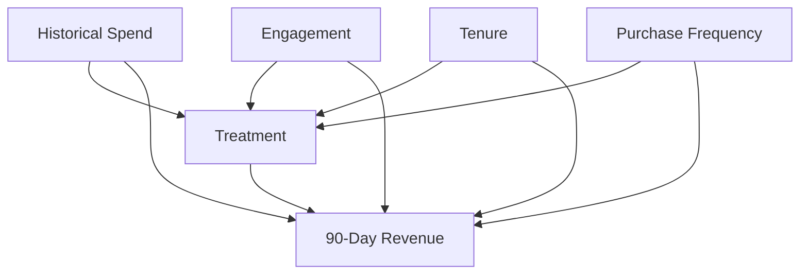

# Automated Causal Inference & Customer Lifetime Value (LTV) Optimization Engine

## 1. Project Overview

This project builds an end-to-end data science engine to estimate the causal impact of marketing interventions on customer behavior and optimize customer targeting based on incremental business value.

Traditional machine learning predicts which customers are likely to purchase, churn, or generate revenue. Causal inference answers a different question:

> Which customers will generate additional value because we intervene on them?

The goal is to move beyond prediction and develop an intervention-based customer targeting strategy using causal inference, survival analysis, and customer lifetime value optimization.

---

## 2. Business Problem

Suppose an e-commerce company runs a marketing campaign by offering discounts to selected customers.

After the campaign, customers who received discounts generated more revenue than customers who did not.

However, this does not necessarily mean that the discounts caused the additional revenue.

The company may have preferentially offered discounts to customers who were already:

- More engaged
- More likely to purchase
- Spending more historically
- More active on the platform

This creates selection bias and confounding.

The business needs to answer:

1. Did the marketing intervention actually cause incremental revenue?
2. How much additional revenue did the intervention generate?
3. Which customers benefited the most from the intervention?
4. Did the intervention improve customer retention?
5. How much additional lifetime value was generated?
6. Which customers should receive the intervention under a fixed budget?
7. How can the company maximize incremental profit instead of targeting customers who would purchase anyway?

---

## 3. Project Objectives

### Objective 1: Estimate the Average Treatment Effect

Estimate the average causal effect of a marketing intervention on 90-day customer revenue.

### Objective 2: Estimate Customer-Level Treatment Effects

Estimate heterogeneous treatment effects to identify customers who benefit differently from the intervention.

### Objective 3: Correct for Confounding

Adjust for observed pre-treatment variables that influence both treatment assignment and customer outcomes.

### Objective 4: Estimate Customer Retention

Use survival analysis to understand the effect of treatment on customer churn and retention duration.

### Objective 5: Estimate Incremental Customer Lifetime Value

Combine incremental revenue and retention effects to estimate the economic value of interventions.

### Objective 6: Optimize Customer Targeting

Rank customers by expected incremental profit and allocate interventions within budget constraints.

### Objective 7: Validate Causal Assumptions

Use causal diagnostics, balance checks, placebo tests, sensitivity analysis, and refutation tests to evaluate the reliability of estimates.

---

## 4. Project Architecture

```text
causal_ltv_engine/
│
├── data/
│   ├── raw/
│   ├── processed/
│   └── synthetic/
│
├── notebooks/
│   ├── 00_project_introduction.ipynb
│   ├── 01_synthetic_data_generation.ipynb
│   ├── 02_data_quality_and_eda.ipynb
│   ├── 03_hypothesis_testing_power.ipynb
│   ├── 04_confounding_and_propensity_scores.ipynb
│   ├── 05_propensity_score_matching.ipynb
│   ├── 06_double_machine_learning.ipynb
│   ├── 07_causal_refutation_dowhy.ipynb
│   ├── 08_survival_analysis_cox.ipynb
│   ├── 09_survival_diagnostics.ipynb
│   └── 10_ltv_optimization.ipynb
│
├── src/
│   ├── __init__.py
│   ├── data_generation.py
│   ├── preprocessing.py
│   ├── causal_models.py
│   ├── survival_models.py
│   ├── ltv_calculator.py
│   └── targeting_policy.py
│
├── reports/
│   ├── figures/
│   └── results/
│
├── tests/
│   ├── test_data.py
│   ├── test_causal_models.py
│   └── test_ltv.py
│
├── requirements.txt
└── README.md
```

---

## 5. Dataset Description

Since a real customer dataset is not provided, the project uses synthetic e-commerce customer data.

The synthetic data contains realistic relationships between customer characteristics, treatment assignment, revenue, and churn.

### Dataset Features

| Feature | Description |
|---|---|
| `customer_id` | Unique customer identifier |
| `tenure_months` | Customer tenure before intervention |
| `historical_spend` | Historical customer spending before intervention |
| `engagement` | Customer engagement score |
| `purchase_frequency` | Historical purchase frequency |
| `treatment` | Whether the customer received the intervention |
| `revenue_90d` | Revenue observed during the 90-day outcome period |
| `duration_months` | Observed time until churn or censoring |
| `churn_event` | 1 if churn occurred, 0 if censored |
| `true_cate` | Simulated true individual treatment effect; evaluation only |
| `true_propensity` | Simulated true treatment probability; evaluation only |
| `revenue_0` | Potential revenue without treatment; evaluation only |
| `revenue_1` | Potential revenue with treatment; evaluation only |

### Treatment Definition

```text
treatment = 1
```

The customer received a marketing intervention.

```text
treatment = 0
```

The customer did not receive the intervention.

### Outcome Definition

The primary outcome is:

`revenue_90d`

This represents revenue generated during the 90 days following the intervention decision.

### Survival Outcome

The survival analysis outcome consists of:

- `duration_months`
- `churn_event`

`duration_months` represents observed time until churn or censoring.

`churn_event = 1` means churn was observed.

`churn_event = 0` means the customer was censored before churn was observed.

---

## 6. Causal Inference Framework

### The Fundamental Problem of Causal Inference

For each customer, we define two potential outcomes:

$$
Y_i(1)
$$

Revenue if customer \(i\) receives the treatment.

$$
Y_i(0)
$$

Revenue if customer \(i\) does not receive the treatment.

The individual treatment effect is:

$$
\tau_i = Y_i(1)-Y_i(0)
$$

However, we can only observe one potential outcome for each customer.

If a customer receives treatment, we observe:

$$
Y_i = Y_i(1)
$$

If the customer does not receive treatment, we observe:

$$
Y_i = Y_i(0)
$$

We cannot observe both outcomes for the same customer.

This is known as the fundamental problem of causal inference.

### Causal Estimands

#### Average Treatment Effect (ATE)

$$
ATE = E[Y(1)-Y(0)]
$$

The average causal impact of treatment across the population.

#### Average Treatment Effect on the Treated (ATT)

$$
ATT = E[Y(1)-Y(0)\mid T=1]
$$

The average causal impact among customers who actually received treatment.

#### Conditional Average Treatment Effect (CATE)

$$
CATE(X) = E[Y(1)-Y(0)\mid X]
$$

The expected treatment effect for customers with characteristics \(X\).

CATE is particularly useful for personalized marketing and customer targeting.

### Causal Assumptions

#### 1. Consistency

The observed outcome equals the potential outcome corresponding to the treatment actually received.

#### 2. Conditional Exchangeability

After adjusting for observed pre-treatment confounders, treatment assignment is independent of potential outcomes.

$$
(Y(1),Y(0)) \perp T \mid X
$$

#### 3. Positivity

Customers with similar covariates must have a non-zero probability of receiving either treatment or control.

$$
0 < P(T=1\mid X) < 1
$$

#### 4. No Interference

One customer's treatment should not affect another customer's outcome.

#### 5. Correct Temporal Ordering

All adjustment variables must be measured before treatment.

Post-treatment variables should not be used as confounders.

---

## 7. Causal DAG

The causal structure of the problem is represented by a Directed Acyclic Graph (DAG).



Historical customer characteristics influence treatment assignment and revenue.

Therefore, a simple comparison between treated and untreated customers may be biased.

---

## 8. Phase 1: Data Generation, Quality & Exploratory Data Analysis

### Notebooks

- `01_synthetic_data_generation.ipynb`
- `02_data_quality_and_eda.ipynb`

### Tasks

- Generate synthetic customer data.
- Inspect data types.
- Check missing values.
- Check duplicate customer IDs.
- Examine distributions.
- Detect outliers.
- Explore treatment assignment.
- Compare treated and untreated customers.
- Examine revenue relationships.

### Important Visualizations

- Revenue distribution
- Historical spend distribution
- Engagement distribution
- Treatment allocation
- Revenue by treatment
- Feature correlation matrix
- Customer tenure distribution
- Churn distribution

### Key Learning

A raw difference in revenue between treated and untreated customers is not necessarily a causal effect.

$$
E[Y\mid T=1]-E[Y\mid T=0]
$$

This is an observational difference.

It may contain both:

- The actual treatment effect
- Pre-existing differences between treated and untreated customers

---

## 9. Phase 2: Statistical Testing and Power Analysis

### Notebook

`03_hypothesis_testing_power.ipynb`

### Hypothesis Testing

Null hypothesis:

$$
H_0: \mu_T-\mu_C=0
$$

Alternative hypothesis:

$$
H_1: \mu_T-\mu_C\neq0
$$

Use a Welch's t-test to compare the mean revenue of the treated and control groups.

### Why Welch's t-test?

Welch's t-test does not assume equal population variances between groups.

### Statistical Power

Power represents the probability of detecting an effect of a specified size when that effect truly exists, under the assumptions of the test.

The project evaluates:

- Significance level
- Minimum detectable effect
- Sample size
- Statistical power

Common planning values:

- Significance level = 0.05
- Statistical power = 0.80

### Key Learning

Statistical significance does not establish causality.

A significant difference can still be caused by confounding.

---

## 10. Phase 3: Confounding & Propensity Scores

### Notebook

`04_confounding_and_propensity_scores.ipynb`

### Confounding

A confounder is a pre-treatment variable that influences both treatment assignment and the outcome.

For example:

```text
Historical spend → Treatment
Historical spend → Revenue
```

Customers with higher historical spending may be more likely to receive discounts and may naturally generate more revenue.

This can produce a biased treatment effect estimate.

### Propensity Score

The propensity score is the probability of receiving treatment given observed covariates.

$$
e(X)=P(T=1\mid X)
$$

We estimate propensity scores using logistic regression.

The propensity score is used to improve comparability between treated and control customers.

### Diagnostics

- Propensity score distributions
- Treatment overlap
- Common support
- Standardized mean differences
- Covariate balance

### Standardized Mean Difference

$$
SMD =
\frac{\bar X_T-\bar X_C}
{\sqrt{\frac{s_T^2+s_C^2}{2}}}
$$

A commonly used balance heuristic is:

$$
|SMD|<0.1
$$

This is a diagnostic guideline, not proof that confounding has been eliminated.

---

## 11. Phase 4: Propensity Score Matching (PSM)

### Notebook

`05_propensity_score_matching.ipynb`

### Objective

Create a comparable control group for treated customers using estimated propensity scores.

### Matching Procedure

1. Estimate propensity scores.
2. Transform propensity scores using the logit.
3. Calculate nearest-neighbor distances.
4. Match treated customers with control customers.
5. Apply a caliper to restrict poor matches.
6. Compare outcomes within matched pairs.
7. Check covariate balance after matching.

### Matching Method

Nearest-neighbor matching without replacement.

A common starting point for a caliper is:

$$
0.2 \times SD(\operatorname{logit}(e(X)))
$$

### Estimand

Matching primarily estimates the ATT when matching treated customers to comparable controls.

### Limitations

- Matching may discard customers.
- Poor overlap can reduce sample size.
- Results depend on the matching specification.
- Matching cannot control unobserved confounders.
- Balance must be checked after matching.

---

## 12. Phase 5: Double Machine Learning (DML)

### Notebook

`06_double_machine_learning.ipynb`

### Objective

Estimate treatment effects while flexibly adjusting for customer characteristics using machine learning.

Double Machine Learning is designed to reduce bias from nuisance-function estimation and uses orthogonalization and cross-fitting to improve inference.

### Nuisance Functions

#### Outcome Model

$$
m(X)=E[Y\mid X]
$$

#### Treatment Model

$$
e(X)=E[T\mid X]
$$

The treatment model estimates the probability of treatment.

The outcome model estimates the expected outcome given covariates.

### Conceptual Steps

1. Split the data into folds.
2. Estimate treatment and outcome nuisance models on training folds.
3. Predict nuisance values on held-out folds.
4. Construct residualized treatment and outcome.
5. Estimate the treatment effect using orthogonal moments.
6. Use cross-fitting to reduce overfitting bias.
7. Estimate ATE and heterogeneous treatment effects.

### Model

`LinearDML`

Nuisance models:

- `RandomForestRegressor`
- `RandomForestClassifier`

### Outputs

- ATE estimate
- ATE confidence interval
- CATE estimates
- CATE distribution
- Treatment effect heterogeneity plots
- Comparison with PSM
- Comparison with simulated ground truth

### Key Learning

DML can flexibly model relationships between covariates, treatment assignment, and outcomes.

However, it still depends on causal identification assumptions, especially the assumption that relevant confounders are observed.

Machine learning does not automatically remove unmeasured confounding.

---

## 13. Phase 6: Causal Refutation with DoWhy

### Notebook

`07_causal_refutation_dowhy.ipynb`

### Objective

Test the robustness of causal estimates using causal refutation methods.

### Refutation Tests

#### Random Common Cause

Adds a random variable to evaluate whether the estimate changes substantially.

#### Placebo Treatment

Creates a placebo treatment and checks whether a spurious causal effect is detected.

#### Data Subset Refuter

Re-estimates the effect using subsets of the data.

#### Sensitivity Analysis

Investigates how conclusions might change under assumptions about unobserved confounding.

### Interpretation

Refutation tests are diagnostic tools.

Passing refutation tests does not prove that the causal estimate is correct.

---

## 14. Phase 7: Survival Analysis

### Notebooks

- `08_survival_analysis_cox.ipynb`
- `09_survival_diagnostics.ipynb`

### Business Objective

Understand how treatment influences customer retention and churn.

Revenue alone may not capture the full long-term value of a customer intervention.

An intervention may:

- Increase short-term purchases
- Improve retention
- Reduce churn
- Have no long-term effect
- Increase revenue while shortening customer lifespan

### Survival Analysis Concepts

#### Survival Function

$$
S(t)=P(T>t)
$$

The probability that a customer remains active beyond time \(t\).

#### Hazard Function

$$
h(t)
$$

The instantaneous risk of churn at time \(t\), conditional on survival up to that time.

#### Cox Proportional Hazards Model

$$
h(t\mid X)=h_0(t)\exp(\beta X)
$$

The model estimates how covariates relate to the hazard of churn.

### Hazard Ratio Interpretation

$$
HR=\exp(\beta)
$$

- HR less than 1: associated with lower churn hazard
- HR greater than 1: associated with higher churn hazard
- HR equal to 1: no association with churn hazard

Hazard ratios are not equivalent to percentage changes in customer lifespan.

### Model Diagnostics

- Cox model coefficients
- Hazard ratios
- Confidence intervals
- Proportional hazards assumption
- Survival curves
- Survival prediction
- Restricted Mean Survival Time (RMST)

### Restricted Mean Survival Time

RMST estimates the expected time customers remain active within a predefined horizon.

$$
RMST(\tau)=\int_0^\tau S(t)\,dt
$$

It provides an interpretable measure of customer retention over a fixed time period.

---

## 15. Phase 8: Customer Lifetime Value (LTV) Optimization

### Notebook

`10_ltv_optimization.ipynb`

### Objective

Combine causal revenue effects and retention insights to create a customer targeting strategy.

The goal is not to target customers who are most likely to purchase.

The goal is to target customers for whom the intervention creates the greatest incremental profit.

### Incremental Revenue

$$
\Delta Revenue_i =
E[Y_i(1)-Y_i(0)\mid X_i]
$$

### Incremental Profit

$$
IncrementalProfit_i =
IncrementalRevenue_i
+
IncrementalRetentionValue_i
-
InterventionCost_i
$$

For a simplified implementation:

$$
Profit_i =
Margin\times CATE_i
+
RetentionMargin\times\Delta RMST_i
-
Cost_i
$$

This formula is an approximation and should only be used if the revenue and retention components are defined over compatible horizons without double-counting.

### Targeting Strategy

1. Estimate customer-level treatment effects.
2. Estimate incremental retention value.
3. Calculate intervention cost.
4. Calculate expected incremental profit.
5. Remove customers with negative expected incremental profit.
6. Rank remaining customers by profit.
7. Allocate the intervention budget.
8. Compare the targeting policy with alternative strategies.

### Targeting Policies

#### Policy 1: Random Targeting

Select customers randomly.

#### Policy 2: Revenue-Based Targeting

Select customers based on predicted revenue.

#### Policy 3: Churn-Based Targeting

Select customers with the highest churn risk.

#### Policy 4: CATE-Based Targeting

Select customers with the largest estimated treatment effect.

#### Policy 5: Profit-Based Targeting

Select customers with the highest expected incremental profit.

The fifth policy is the primary business strategy.

---

## 16. Evaluation Framework

### Causal Evaluation

- ATE
- ATT
- CATE
- Confidence intervals
- Covariate balance
- Propensity score overlap
- Refutation tests
- Sensitivity analysis

### Survival Evaluation

- Kaplan-Meier curves
- Cox hazard ratios
- Proportional hazards diagnostics
- RMST
- Retention comparisons

### Business Evaluation

- Incremental revenue
- Incremental profit
- Intervention cost
- Customers targeted
- Budget utilization
- Policy value
- Incremental profit per customer
- Profit compared with random targeting

---

## 17. Technology Stack

| Technology | Purpose |
|---|---|
| Python | Main programming language |
| NumPy | Numerical computing |
| Pandas | Data manipulation |
| Matplotlib | Visualizations |
| Seaborn | Statistical visualization |
| SciPy | Statistical calculations |
| Statsmodels | Statistical testing |
| Scikit-learn | Machine learning models |
| EconML | Causal inference and treatment effects |
| DoWhy | Causal modeling and refutation |
| Lifelines | Survival analysis |
| Jupyter Notebook | Interactive experimentation |
| Pytest | Testing |

---

## 18. Installation

### Step 1: Clone the Repository

```bash
git clone <your-repository-url>
cd causal_ltv_engine
```

### Step 2: Create a Virtual Environment

```bash
python -m venv .venv
```

Activate the environment.

#### Windows

```bash
.venv\Scripts\activate
```

#### Linux / macOS

```bash
source .venv/bin/activate
```

### Step 3: Install Dependencies

```bash
pip install -r requirements.txt
```

### Step 4: Launch Jupyter

```bash
jupyter notebook
```

---

## 19. Learning Roadmap

| Phase | Topic | Outcome |
|---|---|---|
| 1 | Python data generation | Build a customer dataset |
| 2 | EDA | Understand the data |
| 3 | Statistical testing | Understand significance and power |
| 4 | Confounding | Understand causal bias |
| 5 | Propensity scores | Estimate treatment probability |
| 6 | PSM | Construct comparable groups |
| 7 | DML | Estimate causal effects with ML |
| 8 | DoWhy | Test robustness |
| 9 | Survival analysis | Model customer retention |
| 10 | LTV optimization | Build an intervention policy |

---

## 20. Expected Deliverables

By the end of the project, the repository should contain:

- A synthetic data generator
- A reproducible data pipeline
- Exploratory data analysis
- Statistical power analysis
- Confounding analysis
- Propensity score estimation
- Propensity score matching
- Covariate balance diagnostics
- DML causal estimates
- Heterogeneous treatment effect analysis
- DoWhy causal refutation
- Cox survival analysis
- Survival diagnostics
- RMST estimates
- Customer-level incremental profit estimates
- A budget-constrained targeting policy
- Unit tests
- Visual reports
- A final business recommendation

---

## 21. Important Limitations

### Observational Causal Inference

Causal inference from observational data requires assumptions that cannot always be verified from the data alone.

### Unmeasured Confounding

Unobserved variables may influence treatment assignment and outcomes.

### Synthetic Data

Synthetic data allows us to test methods against known ground truth, but real-world behavior may be more complex.

### Treatment Effect Uncertainty

Individual treatment effect estimates are noisy and should not be treated as perfectly known.

### Survival Analysis Assumptions

The Cox model relies on assumptions such as proportional hazards, which must be evaluated.

### LTV Approximation

Short-term revenue and survival estimates do not automatically equal true lifetime value.

### Business Validation

The final targeting strategy should ideally be tested through a randomized experiment or a well-designed prospective validation.

---

## 22. Final Business Goal

The final system should answer:

> Given a fixed marketing budget, which customers should receive an intervention to maximize expected incremental profit?

Instead of asking:

> Which customers are likely to spend the most?

The goal is to ask:

> Which customers are expected to change their behavior because of our intervention, and how much additional value will that change create?

This is the central shift from predictive analytics to causal decision-making.

---

## 23. Final Summary

This project combines:

- Exploratory data analysis
- Statistical inference
- Confounding analysis
- Propensity scores
- Propensity score matching
- Double Machine Learning
- Causal refutation
- Survival analysis
- Customer lifetime value
- Treatment effect heterogeneity
- Profit optimization

The final product is a causal decision engine that supports marketing decisions based on incremental customer value rather than correlation or predicted customer activity.

---

## Author's Learning Goal

This project is designed to demonstrate practical mastery of:

1. Why correlation is not causation.
2. How confounding creates biased estimates.
3. How propensity scores improve comparability.
4. How matching estimates treatment effects.
5. How Double Machine Learning combines ML and causal inference.
6. How to estimate heterogeneous treatment effects.
7. How to use DoWhy for robustness analysis.
8. How survival analysis models customer retention.
9. How to translate causal estimates into incremental profit.
10. How to build a budget-constrained customer targeting policy.

**The ultimate objective is to build a data science system that estimates the causal impact of interventions and converts those estimates into measurable business value.**
